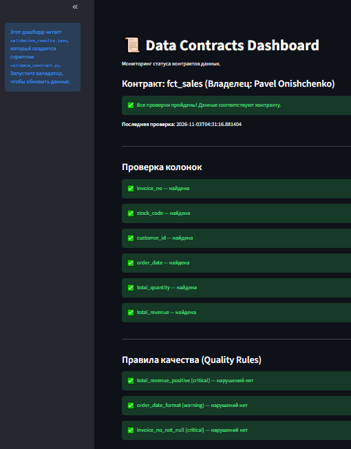

# Data Contracts Demo

Демонстрация подхода **Data Contracts** для контроля качества данных в DWH.

## Что это такое?

**Data Contract** — это официальное соглашение между поставщиком данных и потребителем. Оно описывает:
- Какие колонки должны быть в таблице.
- Какие у них типы.
- Какие ограничения (например, `total_revenue > 0`).
- Кто владелец данных и как часто они обновляются.

Если данные не соответствуют контракту — пайплайн падает с ошибкой. Это предотвращает ситуацию, когда аналитики строят отчеты на «сломанных» данных.

## Что реализовано

- **YAML-контракт** для таблицы `fct_sales` (`contracts/fct_sales_contract.yml`): описание колонок, типов, ограничений и правил качества.
- **Python-валидатор** (`validate_contract.py`): читает контракт, подключается к PostgreSQL и проверяет данные на соответствие. Результаты сохраняются в `validation_results.json`.
- **Streamlit-дашборд** (`dashboard.py`): визуализирует статус контракта (пройден/не пройден), список проверенных колонок и правила качества.
- **CI/CD (GitHub Actions)** (`.github/workflows/validate-contract.yml`): автоматически проверяет YAML-контракт при каждом пуше.

## Стек

- Python (PyYAML, psycopg2)
- PostgreSQL
- Streamlit
- GitHub Actions

## Как запустить

1. Установите зависимости:

    pip install pyyaml psycopg2-binary streamlit

2. Настройте подключение к БД в `validate_contract.py` (или через переменные окружения).

3. Запустите валидатор:

    python validate_contract.py

4. Запустите дашборд:

    streamlit run dashboard.py

## Результат работы

**Валидатор (консоль):**

    🚀 Запуск валидатора Data Contract...
    📄 Контракт загружен: fct_sales (владелец: Pavel Onishchenko)

    🔍 Проверка колонок для dbt_schema.fct_sales...
      ✅ Колонка 'invoice_no' найдена.
      ✅ Колонка 'stock_code' найдена.
      ✅ Колонка 'customer_id' найдена.
      ✅ Колонка 'order_date' найдена.
      ✅ Колонка 'total_quantity' найдена.
      ✅ Колонка 'total_revenue' найдена.

    🔍 Проверка правил качества...
      ✅ total_revenue_positive: нарушений нет.
      ✅ order_date_format: нарушений нет.
      ✅ invoice_no_not_null: нарушений нет.

    🎉 ВСЕ ПРОВЕРКИ ПРОЙДЕНЫ! Данные соответствуют контракту.

**Дашборд (Streamlit):**

## Ссылки

- [Основной проект DWH Marketplace Analytics](https://github.com/nconichtchenko-arch/marketplace-dwh-analytics)
- [dbt CI/CD Demo](https://github.com/nconichtchenko-arch/dbt-ci-cd-demo)
- [dbt + Great Expectations Demo](https://github.com/nconichtchenko-arch/dbt-great-expectations-demo)
